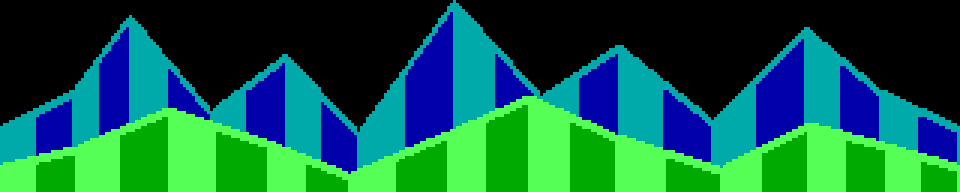
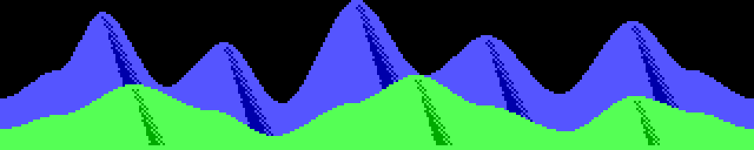

# Ajustes após o primeiro teste do aluno — 07/11/2026

**Atualização de 08/11/2026:** o topo do salto foi corrigido para exatamente 5 pixels reais do terreno, usando avanço de 1 pixel por tick. A suíte completa e o teclado automatizado passaram. Veja [correções e o que retestar](CORRECOES-AUDITORIA.md) e o [checklist do jogador](CHECKLIST-PROFESSOR.md). Não ficou pendente corrigir o topo nem atualizar a suíte. Ainda faltam a rodada física e os esclarecimentos do enunciado registrados na cópia técnica.

O restante deste arquivo registra os ajustes e ensaios históricos de **07/11**, anteriores à correção do topo. As 854 tentativas abaixo não são uma nova medição do fonte de 08/11.

O aluno abriu o jogo e relatou lentidão, salto difícil e relevo excessivamente geométrico. Não realizou o checklist completo. O print enviado em seguida é uma referência visual do jogo on-line, não uma captura comprovando defeito do nosso EXE.

## O que mudou

1. `ferramentas/e08.conf`: CPU de `auto` para **50.000 ciclos** e PATH com T: e Z:. T: contém TASM/TLINK; Z: contém comandos internos auxiliares do DOSBox. Fechar a janela antiga e reabrir `EXECUTAR-E08.cmd` para aplicar.
2. `MOON.ASM`: passo horizontal do jipe de **3 para 5 pixels por atualização**. Permanecem 20×10, X=0..140, altura do salto 15 e subida/descida 3 pixels por frame. A regra do topo continua D05. Não diminuímos obstáculos nem sua área de colisão.
3. `artes/gerar-artes.py`: curvas nos contornos e sombras diagonais menores, substituindo faces verticais em blocos. Montanhas usam azul claro/azul; montes verde claro/verde. Bitmaps de relevo continuam 320×64 e 320×32, com emenda preparada. Os 15 sprites pequenos não mudaram.

O relevo foi gerado como dados do projeto; o programa DOS não calcula curvas e não depende de Python. Foram mantidos o tamanho dos dados (35.431 bytes), o tamanho do código (4.854), a pilha de 256 bytes e as medidas do professor. A resolução continua 320×200; a ampliação da janela ainda evidencia pixels.

## Desempenho medido

Ensaio executa as rotinas reais de composição de 40 quadros (céu, terreno e jipe), sem aguardar a cadência do laço de jogo. Mede capacidade de desenho, **não FPS da partida nem prova de conforto humano**.

| Fonte/configuração | Tempo de 40 composições |
|---|---|
| Anterior, 3.000 ciclos fixos | 5,06 segundos |
| Anterior, 50.000 ciclos | 0,28 segundo |
| Ajustado, 50.000 ciclos | 0,33 segundo |

O primeiro cenário reproduz a capacidade de CPU correspondente ao valor padrão de modo real descrito no [manual oficial do DOSBox, seção 10](https://www.dosbox.com/DOSBoxManual.html#howtospeedup). Não foi medido o computador do aluno durante seu relato, nem capturado o valor efetivo da janela que ele usou. A medição confirma o custo da configuração lenta; não atribui toda oscilação possível do jogo exclusivamente a essa causa. Cadências de movimento continuam próprias: elevar ciclos permite cumpri-las sem tornar o relógio um contador de frames.

**Correção de método:** o PATH antigo continha somente T:, então `config` usado em alguns auxiliares retornava `Illegal command`. Os primeiros ensaios desta sessão não tinham mudado realmente a CPU e foram descartados como comparação de velocidade. O ensaio final usa `Z:\CONFIG.COM`, registra a configuração efetiva nos arquivos `.CPU` e a confere. Declarações históricas de alternância de ciclos por esse comando precisam dessa ressalva; os PASS antigos não demonstram que a alternância de CPU aconteceu.

## Margem do salto

Ensaio controlado com jipe em X=20, **direita + salto**, 61 distâncias iniciais (0..60 pixels livres), sete tipos de obstáculo e duas fases relativas do movimento do terreno: 854 casos por configuração. O sucesso exige sobreviver, completar a travessia e receber +50 uma vez. Sem tiros nesse ensaio.

| Obstáculo/fase | Distâncias seguras antes | Depois |
|---|---|---|
| Rocha, fase 0 | 11 (uma possibilidade) | 17..33 (17 possibilidades) |
| Rocha, fase 1 | 13..16 (4) | 19..40 (22) |
| Cratera, fase 0 | 0..22 (23) | 0..50 (51) |
| Cratera, fase 1 | 0..27 (28) | 0..57 (58) |

O resultado se repetiu nos quatro tipos de rocha e três de cratera. Isso aumenta a margem para **avançar durante o salto**. Não comprova salto parado sobre rocha: com as dimensões e trajetória exigidas, ↑ sozinho pode não permitir a travessia antes de pousar. Testar ↑+→ e recuar antes de chegar ao limite direito; no limite não há espaço para avançar mais.

## Validação executada

- TASM 4.1/TLINK: fonte normal e variantes montadas sem erros/avisos.
- 426 verificações de disparos, resistência, pontuação, limites, cadência e independência.
- 170 quadros / 11.050.000 bytes comparados com composição esperada pelas grades atuais, incluindo HUD sentinela e guarda de memória; imagem real exportada inspecionada.
- 48 verificações de naves, 4.096 sementes e 20.000 passos mistos. O teste de dois passos do jipe passou a esperar 10, pois a configuração mudou intencionalmente de 3 para 5.
- Fluxo controlado: menu, setor, partida, dois canhões, rocha+nave, tiro remanescente, morte/reposição, expiração curta de 6 s, última vida, reinício, restauração do teclado e saída.
- 854 casos de salto por configuração e medição comparativa de composição acima.

O fluxo antigo falhou ao exigir duas vidas restantes: terminou com uma. Seu arranjo deixava a nave emitir vários brancos e o ritmo novo permitiu um encontro adicional. A variante AJAUTO emite explicitamente **um tiro real** e adia a repetição dessa nave, para isolar a única morte prevista pelo caso. Não se mudou o jogo para remover tiros. As verificações de emissão repetida continuam na suíte de 426 casos. A primeira falha e a falha do teste que esperava X=6 estão arquivadas; não foram contadas como aprovações.

Fonte validado: `8F9BF3FAD3C8684B8326DA5CE8F438CFBA672A3944624E7BEE4730E25928F064`. Logs/medidas em [evidências](evidencias/ajuste-jogabilidade/README.md). Não se reaplicou toda a suíte histórica com expectativas de velocidade antiga; a aprovação desta revisão se limita aos ensaios listados. Teclado físico, fluidez percebida, conforto e partida normal de 90 s permanecem a conferir pelo aluno. A revisão E09 anterior descreve outro hash.

## Teste rápido agora

1. Fechar a janela antiga; abrir `EXECUTAR-E08.cmd`, aguardar montagem concluída e digitar `MOON`.
2. Comparar resposta do menu e movimento do cenário, sem iniciar todo o checklist.
3. Na partida, deixar o jipe com espaço à direita. Aproximando-se de uma rocha, pressionar ↑ junto com →; soltar ↑ para o próximo salto. Testar mais de uma tentativa e observar +50 após pouso seguro.
4. Experimentar Espaço no chão/ar, uma perda de vida e retorno ao menu.
5. Relatar separadamente: ainda trava? movimento ficou rápido demais? salto ficou executável? relevo melhorou?

Se abrir pelos botões da IDE, conferir que ela usa a mesma configuração de CPU: a alteração no arquivo e08.conf não modifica automaticamente preferências internas da IDE. Registrar o valor do título/configuração. O [manual do DOSBox](https://www.dosbox.com/DOSBoxManual.html) descreve ajuste de ciclos e alerta que valores excessivos também podem reduzir desempenho; 50.000 foi o valor testado neste computador, não uma garantia para todo hardware.
