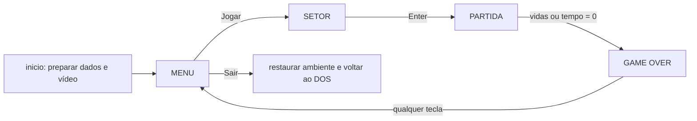

# Entender o código para apresentar em dupla

Este roteiro é para alguém que recebeu a pasta sem ter participado dos chats. Revisado por inspeção em 08/11/2026 para o fonte identificado no [mapa](MAPA-DO-CODIGO.md): passo horizontal de 5 e terreno de 1 pixel por tick. Para separar arquivos e estudar em outro chat, comece em [estudo/README.md](estudo/README.md). Esta revisão documental não executou testes nem concluiu o checklist. Não pressupõe que ler um resumo seja suficiente para dominar Assembly. O objetivo é conseguir **explicar e simular cada rotina**, depois relacioná-la ao que se vê no jogo.

Comecem pelo [README](README.md) e façam os encontros abaixo. Podem estudar enquanto a rodada do [checklist](CHECKLIST-PROFESSOR.md) está pendente; ao terem acesso ao computador, relacionem as explicações com o jogo e registrem os testes. A duração sugerida é 30–45 minutos por encontro, podendo dividir os assuntos difíceis. Não tentem decorar as milhares de linhas de dados gráficos.

## Como estudar juntos

Em cada encontro, uma pessoa explica e a outra faz perguntas; depois troquem. Ambos devem entender o programa inteiro, mesmo que dividam a fala na apresentação. Mantenham um registro com: assunto, rotina, explicação própria, exercício feito e dúvidas. Não marcar “entendi” apenas porque a descrição pareceu clara.

Para cada procedimento, respondam:

1. Qual comportamento do jogo ele produz e quem o chama?
2. Quais registradores/variáveis recebe e quais resultados entrega?
3. Quais registradores preserva e quais altera? O que acontece com as flags?
4. O que muda na memória, nos objetos ou na tela?
5. Qual é um exemplo normal, um caso de limite e um caminho de retorno antecipado?
6. Que requisito do professor atende e qual parte é decisão técnica nossa?

O [mapa completo](MAPA-DO-CODIGO.md) contém os contratos das 69 rotinas e seus locais no fonte. Os cabeçalhos são uma ajuda: confirmem a explicação seguindo as instruções do corpo. O [guia de apresentação](GUIA-APRESENTACAO.md) é a síntese para depois do estudo, não substitui essa leitura.

## Encontro 1 — O jogo inteiro e o laço principal

**Ler:** README, constantes `ESTADO_*`, `inicio`, `LerTeclado`, `EntrarMenu`, `EntrarSetor`, `EntrarPartida`, `EntrarGameOver`. Usar a busca do editor pelo nome seguido de `proc`; não depender de números de linha de outra versão.

Estado é uma variável que indica qual tela está ativa. O laço principal consulta teclado, verifica saída e chama a atualização apropriada. Menu tem animação; partida tem relógio, movimento e colisões. Setor e fim esperam entrada. Não há cinco jogos rodando separados nem uma pausa que bloqueia tudo até apertar tecla.

`CALL` entra numa rotina guardando o endereço de retorno; `RET` volta. `JMP` apenas muda o ponto de execução, sem criar um retorno. Os nomes como `cicloPartida:` são rótulos internos, não necessariamente procedimentos novos.

**Exercício:** traçar no papel abrir → Jogar → Enter → perder vidas → Game Over → menu → Sair. Anotar em cada seta o procedimento e a mudança em `estado`. Depois explicar por que o primeiro Enter não inicia diretamente a partida.

**Concluir quando:** ambos conseguem narrar esse fluxo sem ler o guia e localizar o reinício de score/tempo/vidas.

## Encontro 2 — Vocabulário de Assembly e organização da memória

**Ler:** começo de MOON.ASM, `.data`, contratos das primitivas e LEIA-E01. O programa é `.8086`, `.model small`, tem segmentos separados de código/dados e pilha de 100h = 256 bytes. Não significa que a máquina inteira só possua 64 KiB; cada segmento usado nesse modelo tem limite de 64 KiB.

| Conceito | Significado neste projeto |
|---|---|
| Bit / byte / word | 1 bit; byte = 8 bits; word = 16 bits = 2 bytes |
| Hexadecimal | Sufixo h; 0Ah=10, 0Fh=15, 100h=256, FFFFh=65535 sem sinal |
| DB / DW | Reservam/inicializam bytes ou words na montagem |
| EQU | Define símbolo constante; não cria uma variável mutável em memória |
| DUP | Repete uma definição de dados; não é laço executado a cada frame |
| `?` em dados | Reserva sem garantir valor útil; inicializar antes de ler |
| AX/BX/CX/DX | Registradores de 16 bits; AX se divide em AH e AL, de 8 bits |
| SI/DI | Usados como índices/origem/destino conforme contrato de cada rotina |
| DS/ES/CS/SS | Segmentos de dados, extra (vídeo aqui), código e pilha |
| SP/BP | SP acompanha topo da pilha; BP também é usado como temporário, com cuidado de endereçamento |
| `mov ax,jipeX` | Lê o valor armazenado na variável |
| `lea si,bitmapJipe` | Obtém o deslocamento/endereço dos dados; não lê todos os pixels |
| `[di]`, `tabela[di]` | Acesso indireto à memória; DI normalmente mede bytes, não “número de objeto” |
| `push` / `pop` | Guardar/recuperar valor na pilha, em ordem inversa |
| `INT` / `IRET` | Interrupção de software / retorno de interrupção; não intercambiáveis com CALL/RET |

Listas word usam offsets 0,2,4…: a segunda nave usa `naveX[2]`, `naveY[2]`, `naveAtiva[2]`. `naveX[1]` leria uma word começando no meio da primeira entrada.

**Exercícios:** converter 13h para decimal (19); explicar por que modo 13h não significa 13 cores; mostrar como AH/AL formam AX; encontrar exemplos de byte e word; apontar em que segmento está o vídeo e por que ele não ocupa o buffer de dados do jogo.

## Encontro 3 — Instruções, comparações e flags

**Ler:** `PrepararRetangulo`, `SomarPontos`, `RemoverNave`, `FormatarNumero`, `Sortear`.

| Grupo | O que compreender |
|---|---|
| MOV, LEA | Copiar valor versus obter endereço |
| ADD/SUB/INC/DEC | Atualizar valores; INC/DEC não atualizam CF como ADD/SUB |
| CMP | Subtração para atualizar flags sem guardar o resultado |
| JE/JNE, JZ/JNZ | Igualdade/zero |
| JB/JBE/JA/JAE | Comparações sem sinal |
| JL/JLE/JG/JGE | Comparações com sinal; necessárias para X negativo saindo da tela |
| JC/JNC, STC/CLC | Consultar/definir carry, também usado como resultado booleano de rotinas |
| AND/OR/XOR/TEST/NOT | Manipular bits; TEST só testa, sem gravar máscara |
| SHL | Deslocar bits; `shl bx,1` multiplica índice por 2 quando cabe |
| MUL/DIV | Versões word usam DX:AX; divisão devolve quociente AX e resto DX |
| ADC/SBB | Somar carry/subtrair empréstimo para operar valores maiores que 16 bits |
| LOOP | Decrementa CX e repete se não ficou zero; exige atenção ao valor inicial |
| REP/CLD | Repetição por CX e direção crescente nas instruções de strings |

Em `SomarPontos`, se score=65500 e ganho=50, a soma excede 65535; CF sinaliza isso e o código guarda 65535 em vez de retornar a um número pequeno. Em `RemoverNave`, CF=1 significa “esta chamada removeu uma nave”. O chamador deve testar imediatamente: outra instrução aritmética pode substituir esse resultado.

`FormatarNumero` divide por 10 repetidamente e soma `'0'` ao resto para obter caractere. Para 150 num campo de cinco posições, os restos são escritos da direita para a esquerda e o resultado é `00150`.

**Exercícios:** simular soma 100+50 e 65500+50; explicar por que X=-1 precisa comparação com sinal; converter 150 para cinco dígitos seguindo DIV; escolher três desvios e dizer exatamente qual condição leva a cada ramo.

## Encontro 4 — Pixels, bitmaps, transparência e texto

**Ler:** `PrepararRetangulo`, `DesenharBitmap`, `DesenharSprite`, `SalvarFundo`, `DesenharSpriteRecortado`, `LimparTela`, `EscreverTexto`, `MostrarArte`; [artes](artes/README.md).

Um pixel é um índice de cor, um byte. Endereço: `A000h:(y*320+x)`. Em (100,10), deslocamento 3300=0CE4h. Último pixel (319,199) tem deslocamento 63999=F9FFh. A posição (320,0) é inválida como coordenada da primeira linha, mesmo que 320 seja um deslocamento válido para (0,1).

Para um jipe 20×10 em (0,183), o primeiro deslocamento é 183×320=58560. Após copiar 20 pixels, faltam 300 posições até o início da próxima linha. Dez linhas totalizam 200 bytes de sprite, não 3200 bytes de pixels coloridos do jipe.

`REP MOVSB` copia DS:SI para ES:DI e consome CX. `LODSB` lê byte de DS:SI em AL. `STOSB` grava AL em ES:DI. Com `CLD`, SI/DI avançam. `DesenharSprite` ignora FFh: o fundo permanece. Preto 00h é um pixel opaco e deve ser desenhado. FFh é uma convenção do código, não transparência automática do modo 13h.

Recorte horizontal permite X negativo ou parcialmente fora da direita. O endereço no vídeo deve continuar válido; parte da imagem original é pulada. A rotina não oferece recorte vertical arbitrário: os limites da lógica garantem Y válido.

Texto é uma exceção permitida: `EscreverTexto` usa BIOS, temporariamente aponta ES:BP para os caracteres e depois restaura ES do vídeo. Coordenadas de linha/coluna de texto não são as coordenadas de pixels.

**Exercícios:** simular uma linha de sprite `FFh,00h,0Eh` sobre fundo azul; resultado preserva azul, desenha preto, desenha amarelo. Explicar por que apagar o jipe sempre com preto danificaria o relevo. Identificar no gerador de artes como ponto vira FFh e hex vira cor; mostrar que esses bytes já estão no ASM.

## Encontro 5 — Menu, terreno e composição do quadro

**Ler:** rotinas de menu, `AvancarCenario`, `ComporLinhaCircular`, `DesenharCenario`, `DesenharStatus`, `DesenharQuadroPartida`.

No menu, o fundo é estático: apagar todos → mover → capturar todos os fundos limpos → desenhar todos. Se capturar depois de desenhar outro objeto, o fundo salvo pode conter esse objeto e criar rastros.

No terreno, `rolagem` seleciona a coluna da arte que aparece na borda esquerda. Com largura 320 e passo atual de 1 pixel, avançar de 319 volta a 0. Um buffer de 320 bytes compõe só uma linha; não há cópia integral de tela em DS. Montanhas e montes são sobrepostos nesse buffer, que é enviado ao vídeo. A pista é desenhada no fim.

Na partida: céu/naves → cenário/obstáculos → tiros → salvar fundo atual e desenhar jipe. Flags `cenarioMudou`, `jipeMudou`, `navesMudou` e `tirosMudou` decidem recomposição. São variáveis de memória, diferentes das flags CF/ZF do processador. Um fundo capturado antes de o cenário rolar não pode ser restaurado depois como se ainda fosse atual.

**Exercícios:** mostrar colunas de origem para rolagem 0,1,319; simular um tiro removido sem movimento do terreno e explicar por que ainda é preciso redesenhar; distinguir desenhar status de alterar score.

## Encontro 6 — Tempo real e cadência de movimentos

**Ler:** `EntrarPartida`, `AtualizarPartida`, `AtualizarAnimacao`, `LerCentissegundos`, `AtualizarRelogio`, `ConsumirTempo` e rotinas de cadência.

Dois conceitos separados: ticks BIOS decidem quando dar passos de movimento; hora DOS em centésimos determina duração da partida. Se o jogador soltar o teclado, ambos continuam. Se o desenho atrasar, não se deve contar “um segundo por frame”.

`LerCentissegundos` combina hora/minuto/segundo/fração num valor DX:AX, maior que 16 bits. `AtualizarRelogio` subtrai a última amostra com SUB/SBB e trata virada de dia. `ConsumirTempo` guarda fração não consumida, divide por 100, subtrai só segundos completos e limita a zero. Há margem inicial de 6 centésimos para a resolução observada; é uma decisão técnica, não regra do professor.

**Exercício:** assumindo margem inicial já consumida, acumular consultas de 30,40 e 50 centésimos: após as duas primeiras há 70 sem desconto; na terceira há 120, desconta 1 segundo e sobra 20. Explicar por que movimento horizontal de 5 px por tick e nave de 1 px a cada 2 ticks dão velocidades diferentes. A subida/descida do salto continua 3 pixels por frame. Explicar por que teste de 6 s não substitui medição de 90 s.

## Encontro 7 — Teclado físico e interrupções

**Ler:** `LerTeclado`, `RegistrarScanJipe`, `TecladoJogoIRQ`, `InstalarTecladoJogo`, `RestaurarTecladoJogo`.

No menu/setor/fim, INT 16h verifica buffer e lê somente se existir tecla. Na partida, é preciso distinguir pressionar, segurar e soltar, inclusive simultaneamente. IRQ1 registra eventos em bits e pedidos; não movimenta nem desenha o jipe.

Exemplo: `BIT_DIREITA=2`, `BIT_CIMA=4`. Juntas produzem máscara 6. AND/TEST consultam o bit; OR ativa; AND com máscara inversa desativa. A posição ainda é atualizada pela rotina do jipe, no seu tempo.

O bit 7 do scan indica soltura. ↑ só cria pedido em nova pressão no chão; repetição automática não cria saltos sucessivos. Pedidos transitórios são copiados/limpos em seção curta protegida por PUSHF/CLI/POPF. A máscara de tecla mantida continua existindo depois que o pedido foi consumido.

`TecladoJogoIRQ` salva AX/DS, aponta DS para os dados, lê porta 60h, faz confirmação pela porta 61h, registra scan, envia fim de interrupção ao PIC na porta 20h, restaura e usa IRET. Não chama DOS/BIOS nem desenha dentro do tratador. Serviços DOS 35h/25h obtêm/instalam o vetor INT 09h; o vetor antigo é restaurado antes de Game Over/saída. Entendam essas etapas pelo código, sem experimentar alterações aleatórias nas portas.

**Exercícios:** simular direita pressionada, cima pressionada, direita solta e cima solta; acompanhar bits/pedido. Explicar por que IRET não é RET; por que salvar DS; por que a rotina de interrupção deve ser curta; e por que entrada sintética não comprova conforto com teclado físico.

Esta é uma das partes menos elementares da solução. Não dizer que é “óbvia” para cumprir o desejo de simplicidade: estudar com calma ou pedir uma explicação instrução por instrução.

## Encontro 8 — Movimento e salto do jipe

**Ler:** `ReiniciarJipe`, `AtualizarJipe`, `ContarTopo`, `CapturarEDesenharJipe`.

Origem é canto superior esquerdo. Jipe inteiro limitado às colunas 0..159: X máximo=160−20=140. Pista começa em 193; jipe de altura 10 no chão começa em 183. No topo começa em 168, mantendo dimensões.

Sequência de Y na subida: 183 → 180 → 177 → 174 → 171 → 168. Fase muda de subida para topo. A permanência conta avanço do terreno; na configuração atual de 1 pixel por tick, observa 1,2,3,4,5 e passa à descida ao atingir 5. AtualizarPartida conta o terreno antes de atualizar o jipe; na atualização que atinge o limiar, AtualizarJipe já pode descer. É a decisão D05 quanto ao referencial: não são 5 pixels de mudança em jipeX. Relatórios antigos de passos 2,4,6 descrevem outra versão. Depois desce em passos de 3 até 183. Não atribuir essa referência ao professor como se ele a tivesse confirmado.

**Exercícios:** simular X=139 com direita (limita a 140), X=1 com esquerda (limita a zero); acompanhar salto enquanto X aumenta; explicar por que parado/limite não deixam o topo preso nessa implementação.

## Encontro 9 — Obstáculos, colisões, vidas e pontuação

**Ler:** `ReiniciarObstaculos`, `AvancarObstaculos`, `SobrepoeObstaculo`, `ConferirObstaculos`, `SomarPontos`, `PerderVida`, `TentarReporJipe`, `RetirarObstaculos` e `DesenharObstaculos`.

Oito vagas em tabelas paralelas: posição, tipo, estado de passagem, impactos. FFFFh em tipo indica vaga livre. Tipos 0..2 são crateras; 3..6 rochas. A sequência de geração alterna cratera/rocha/cratera, sorteando tipos e distâncias; 150 é espaço livre entre crateras nesta convenção, não distância entre suas origens.

Retângulos usam intervalos `[início,fim)`: jipe em X=20 ocupa até 39; obstáculo começando em 40 apenas encosta, sem sobrepor. Se começar em 39, há sobreposição. Cratera exige também apoio no chão; rocha testa altura do bloco. A transparência do desenho não recorta o retângulo de colisão.

Pontuação por salto acompanha: objeto à frente → sobreposição no salto → objeto inteiramente atrás → pouso seguro → +50 uma vez. Primeiro a rotina verifica todas as colisões, depois os pontos. Morte cancela candidatas. Essa espera pelo pouso é uma decisão adicional que deve ser explicada na revisão de conformidade.

`PerderVida` atua só se jipe ativo, torna-o ausente e reduz uma vida. Mundo, tempo e score continuam. Reposição tenta X=0 quando a área está livre de obstáculo e tiro, sem invulnerabilidade. Ausente e fora da tela são conceitos diferentes.

**Exercícios:** comparar duas bordas encostadas versus um pixel sobreposto; simular salto seguro e salto com morte antes do pouso; explicar por que repetir a chamada de PerderVida no mesmo evento não retira outra vida; acompanhar reutilização de vaga e reset de impactos.

## Encontro 10 — Sorteio e grupos de naves

**Ler:** `Sortear`, `ReiniciarNaves`, `ContarNavesAtivas`, `GerarGrupoNaves`, `RemoverNave`, `AtualizarNaves`, `AtualizarCadenciaNaves`, `DesenharNaves`.

Semente é estado do gerador pseudoaleatório. Próxima semente=(anterior×25173+13849) módulo 65536; usa byte alto e resto para caber no limite CX. Não é acaso perfeito, nem é necessário ser criptográfico. Sequências podem repetir; nascer um tipo igual ao grupo anterior não é defeito.

Grupo tem tipo compartilhado, quantidade sorteada 1..3, X/Y por nave e três flags de atividade. Quantidade sorteada não substitui contagem atual de ativas após mortes/saídas. Naves ainda fora da direita contam como ativas, evitando criar grupos antes da hora.

A formação reserva largura dos sprites e espaços mínimos antes de sortear sobras, sem ficar tentando posições infinitamente. Para três naves, 3×14+2×30=102; sobram 58 dos 160 pixels da formação. Essa largura é a interpretação D06. Y de origem vai de 15 a 86; último pixel da mais baixa é 99.

**Exercícios:** calcular sobra para 1,2,3 naves; remover duas de três e explicar por que não nasce outro grupo; remover a mesma vaga duas vezes e acompanhar CF; distinguir saída pela esquerda (zero pontos) de impacto (+100 no chamador).

## Encontro 11 — Disparos e interação entre sistemas

**Ler:** todas as rotinas de `ReiniciarDisparos` até `DesenharDisparos`, usando o mapa para os contratos.

Há 28 vagas: 8 superiores, 8 frontais, 12 inimigas. Cada propriedade está num vetor word. Offsets em bytes: superiores 0..14, frontais 16..30, inimigos 32..54; o fim exclusivo é 56. `TipoDoTiro` converte faixa do slot em índice de tabelas de tamanho/bitmap.

`DispararJipe` primeiro encontra vaga em ambas as faixas. Só cria quando consegue o par inteiro; não apaga tiros ativos para encaixar outro. Superior nasce no canhão de cima, frontal no da frente. Cadência limita repetição; tocar durante recarga é descartado, segurar repete quando pode.

`MoverDisparos` faz passos internos de um pixel, testando cada posição, mesmo quando deslocamento total é 4. Evita pular um alvo fino. Frontal guarda distância percorrida independente da posição posterior do jipe. Tiros não dependem da continuidade da vida do emissor.

`ConferirUmDisparo` escolhe alvos: superior→nave, frontal→rocha, branco→jipe/pista. Rocha 1 não destrói; 2/3 um impacto; 4 dois na mesma instância sem prazo. Um tiro é consumido no primeiro efeito/limite. Destruir nave usa retorno CF de `RemoverNave` para conceder +100 uma vez. `TiroNaReposicao` evita recriar jipe sobre branco.

**Exercícios:** apontar a vaga frontal inicial em bytes; simular tiro que percorreu 49 e avança até 50; primeiro/segundo impacto da rocha 4; morte da nave enquanto tiro branco continua; dois tiros chegando ao mesmo alvo e por que não pontuam duas vezes.

## Encontro 12 — Integração, testes e ensaio

Voltem a `AtualizarPartida`. Reconstruam a ordem real: tempo → amostra de ticks → naves → cenário/obstáculos/topo → jipe/reposição → tiros → colisões/pontos terrestres → fim por vidas → liberação de obstáculos → HUD → composição visual. Identifiquem que testes de colisão podem acontecer mesmo sem passo de um projétil, porque o alvo pode ter se movido.

Expliquem a diferença entre fonte do jogo, arquivo montado, variante de teste e evidência. Um teste que escreve posições controladas verifica uma condição; não prova que ela é confortável de executar com a mão. Hash igual identifica bytes do fonte, não substitui executar no ambiente final. Há evidências de E09 e de auditorias/ajustes posteriores; confira a versão de cada ensaio. Não atribua aprovações antigas ao fonte novo. Falta concluir o checklist humano, e a auditoria registrou expectativas antigas na suíte.

Consultem as decisões do professor/aluno/técnicas. Façam o roteiro de apresentação e as perguntas de GUIA-APRESENTACAO. Demonstrem tanto o jogo quanto trechos de código que sustentem a explicação. Não apresentem escolhas técnicas como frases do professor.

**Conclusão do estudo:** cada integrante consegue acompanhar cada procedimento pelo mapa, calcular um endereço de vídeo, traçar entrada→movimento→colisão→desenho, explicar limites/flags e dizer quais testes realmente foram feitos. Dúvidas restantes ficam anotadas para nova sessão, sem fingir domínio.

## Modelo para registrar aprendizagem

| Encontro/data | Integrante que explicou | Rotinas lidas | Exercício e resposta própria | Dúvida | Próxima leitura |
|---|---|---|---|---|---|
| A preencher | — | — | — | — | — |

## Prompt para começar a tutoria

> Quero estudar o encontro 1 de ESTUDO-DO-CODIGO.md. Leia o README, o estudo, o mapa e o fonte atual. Não altere código. Explique em português simples, partindo do que aparece na tela, e acompanhe comigo inicio e as mudanças de estado. Use trechos pequenos e exemplos de registradores/variáveis. Faça uma pergunta de compreensão por vez e espere minha resposta antes de avançar. Meu colega deve conseguir acompanhar só com os arquivos do projeto. Ao final, resuma o que entendemos e as dúvidas para registrar no Markdown.

Para os próximos encontros, trocar o número. Para aprofundar uma rotina:

> Explique a rotina [nome] do MOON.ASM instrução por instrução. Mostre chamadores, entradas, saídas, registradores preservados/alterados, flags, dados e efeitos no jogo. Simule um caso normal e um limite com uma tabela de valores. Diferencie requisito do professor de decisão do projeto. Não refatore nem implemente nada durante esta explicação.

Não é necessário reler os 12 encontros em todo chat: usar README, encontro escolhido, mapa e estado atual, consultando fontes conforme a dúvida.
