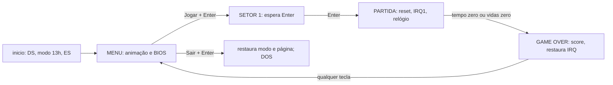

# Moon Patrol — guia de apresentação

Se ainda não entende o código, comece pelo [roteiro de estudo em dupla](ESTUDO-DO-CODIGO.md) e pelo [mapa de todas as rotinas](MAPA-DO-CODIGO.md). Antes do ensaio, registre o que realmente funciona no [checklist baseado no enunciado](CHECKLIST-PROFESSOR.md). Este guia é uma síntese para apresentar, não comprovação de domínio nem de testes físicos.

Material preparado na E09 em 02/11/2026 e finalizado em 06/11 para a versão completa de `MOON.ASM`. Preparar este guia não significa que a apresentação ocorreu. Leia o estado de validação em [LEIA-E09](LEIA-E09.md). O programa tem uma fase, menu, setor, partida e encerramento; inclui os disparos da E08.

## Sequência curta de demonstração

Ensaie em GUI Turbo Assembler/Windows, **Turbo 16-bit**. A sequência abaixo é um roteiro a executar, não um registro de execução humana.

1. **Fonte e montagem (30–45 s):** abra `ABRIR-GUI.cmd`. Se a IDE restaurar uma aba antiga, feche-a sem gravar e reabra `C:\ucs\moon_patrol\MOON.ASM`. Confira a primeira linha E09. Use **Assemble**, **Build** e **Run**, nessa ordem; leia as mensagens de sucesso. Se houver erro, não rode um EXE antigo.
2. **Menu (20 s):** mostre Moon Patrol verde, as quatro figuras animadas, caixas Jogar/Sair e seleção com ↑/↓. Enter em Jogar leva a SETOR 1. Explique que o relógio começa na partida, depois do primeiro desenho; Enter inicia.
3. **Movimento e salto (30–45 s):** mostre score/vidas/tempo, terreno à esquerda e pista amarela. Mova o jipe aos limites; salte parado e com movimento. Solte ↑ antes de saltar novamente. Explique altura 15 e topo contado pelo avanço do terreno.
4. **Obstáculos e tiros (60–90 s, conforme os encontros):** demonstre Espaço produzindo os dois tiros, inclusive no ar. Busque uma travessia segura (+50), uma rocha destrutível (+50) e uma nave (+100). Observe o grupo homogêneo e os tiros brancos. A rocha 1 exige salto; 2/3 recebem um impacto; 4 recebe dois. Não prometa encontrar todos os tipos numa única partida: o sorteio pode repetir.
5. **Vida e encerramento (30–60 s):** mostre uma colisão, uma vida a menos e reposição na coluna zero quando livre. Termine por vidas, confira GAME/OVER e score. Qualquer tecla volta; inicie novamente para mostrar 3 vidas/0 pontos/90 s. Retorne ao menu e selecione Sair. O aviso `Press any key to exit...`, se aparecer, é do lançador da IDE.

Reserve uma partida adicional para sobreviver até os 90 s e comparar com cronômetro externo; isso pode ultrapassar o tempo da demonstração curta. Não troque o EXE normal por um harness sem explicar. Os testes controlados ajudam a comprovar casos raros, mas não são jogabilidade humana. Durante a partida não há atalho Esc para sair: o fluxo normal encerra por tempo ou vidas.

## Explicação inicial em um minuto

“O jogo usa Assembly 8086 e vídeo 13h. Cada pixel é um byte em A000h. Os desenhos são bitmaps com transparência, copiados por memória. Um laço consulta o estado da tela, o relógio e o teclado; as rotinas de lógica atualizam posições, colisões e pontuação antes de desenhar. Uso listas fixas para obstáculos, naves e tiros. Ao morrer, apenas o jipe fica ausente; o mundo e o relógio continuam. Uma nova partida reinicia tudo.”

Explique em suas palavras; não memorize nomes sem entender o que recebem e alteram.

## Fluxo do programa

`inicio` guarda modo/página anteriores, configura DS e ES e chama `EntrarMenu`. O laço chama `LerTeclado`; no menu atualiza animação, na partida chama `AtualizarPartida`. Setor e fim aguardam entrada sem consumir tempo de partida. `EntrarGameOver(AX=score)` restaura o vetor de teclado antes de usar novamente o BIOS.

Em `AtualizarPartida`, a ordem é: consumir tempo; amostrar ticks BIOS; mover/gerar naves; avançar cenário/obstáculos e contar topo; mover ou repor jipe; mover/emitir/conferir tiros; conferir colisões e travessias terrestres; verificar vidas; liberar obstáculos; atualizar HUD e compor o quadro quando necessário. A prioridade dos tiros permite destruir uma rocha antes da colisão terrestre daquele ciclo e cancelar candidatas de salto quando um branco mata o jipe.

## Dados, registradores e memória

| Elemento | Representação e motivo |
|---|---|
| Estado e HUD | `estado`, `vidas`, `scorePartida`, `tempoRestante`; score word sem sinal, cinco dígitos, teto 65535 |
| Jipe | X/Y, fase do salto, bits de teclas e pedidos; `jipeAtivo` distingue vivo de aguardando reposição |
| Obstáculos | Oito posições signed, tipos, estados de travessia e impactos. Tipo FFFFh significa vaga livre |
| Naves | Três vagas X/Y/ativa, quantidade sorteada e um tipo comum ao grupo; atividade real controla a renovação |
| Tiros | Quatro vetores word: ativo, X, Y, distância; 28 vagas divididas em 8 superiores, 8 frontais e 12 inimigas |
| Sorteio | `semente` compartilhada entre obstáculos e naves, inicializada somente em nova partida |
| Imagens | 17 bitmaps autorais (32.932 bytes) e três retângulos de tiro. `DB` armazena bytes; `DUP` repete dados na montagem |
| Buffers | Uma linha de cenário de 320 bytes; fundo do jipe de 200 bytes; fundos próprios dos quatro objetos do menu |

Cada word ocupa dois bytes: índices de listas avançam 0, 2, 4 etc. SI costuma apontar para a origem de uma cópia ou para um tiro; DI seleciona uma vaga ou o destino no vídeo. BX pode indexar tabelas por tipo. Os contratos de cada rotina definem o significado naquele contexto.

`.model small` separa código e dados em segmentos de até 64 KiB. DS aponta para dados; ES=A000h para vídeo; CS para código; SS:SP para pilha. O mapa normal registra 35.431 bytes de dados, 4.854 de código e pilha de 256 bytes. Os 64.000 bytes de vídeo são outra região, não um buffer dentro de DS. `CALL` guarda retorno na pilha; `PUSH`/`POP` preservam registradores. Não há alocação dinâmica nem dependência de Python no jogo.

## Vídeo e desenho por memória

O endereço é `A000h:(y*320+x)`. Em (100,10), o deslocamento é 3300 = 0CE4h. O último pixel, (319,199), é 63999 = F9FFh. Um byte contém um índice de cor, não três componentes RGB.

`PrepararRetangulo` valida o retângulo inteiro e devolve DI inicial, altura em BP e salto entre linhas em BX; CF=1 indica inválido. `DesenharBitmap` usa `REP MOVSB` para cópia opaca, `DesenharSprite` usa `LODSB` e escrita indireta, ignorando FFh. **00h é preto opaco; FFh é a transparência convencionada pelo jogo.** `CLD` garante avanço de SI/DI nas instruções de strings. `REP STOSB` preenche regiões. INT 10h é usada para modo/texto, não para desenhar pixels de sprites.

`DesenharSpriteRecortado` compartilha a primitiva e recorta entradas/saídas horizontais. Coordenadas X negativas são válidas para um objeto parcialmente fora da esquerda; por isso comparações signed. Os limites de criação/movimento garantem altura válida. Não há uma rotina de desenho duplicada para cada tipo de nave ou rocha.

O menu restaura todos os fundos salvos, move, captura todos os fundos limpos e depois desenha os objetos. Na partida o terreno muda: `ComporLinhaCircular` monta uma linha usando `rolagem` módulo 320, sobrepõe montanhas e montes e copia a linha pronta. As camadas movem juntas, sem paralaxe; pista ocupa Y=193..199.

A composição da partida é **céu/naves → cenário/obstáculos → tiros → captura e desenho do jipe**. As flags de mudança decidem as regiões a recompor. Quando apenas o jipe muda, restaura sua captura atual. Quando o terreno ou um tiro muda, recompõe o fundo para não restaurar pixels antigos. Não há sincronização com retraço vertical; a inspeção de pixels não aprova fluidez ou ausência de rasgos.

## Tempo, teclado e salto

Ticks BIOS (`INT 1Ah`) determinam quando executar passos: jipe horizontal 5 px/1 tick após o ajuste de 07/11, naves 1 px/2 ticks, cenário 2 px/2 ticks. A subida/descida permanece 3 px/frame. São cadências nominais; um desenho demorado pode atrasar movimento. O cronômetro usa hora DOS (`INT 21h/AH=2Ch`), convertida em centésimos DX:AX. Subtrações `SUB/SBB` calculam o intervalo, somado à fração restante; `DIV 100` separa segundos e resto. Uma margem inicial de 6 centésimos cobre a resolução observada, uma vez por sessão. Relógio e movimento não dependem da repetição de teclas. Ver [ajustes e medições](AJUSTES-JOGABILIDADE.md).

Menu/setor/fim consultam INT 16h sem bloquear a animação. Durante a partida, `TecladoJogoIRQ` trata make/break da IRQ1, registra bits e retorna com IRET, preservando o contexto. Não desenha e não chama DOS/BIOS dentro da interrupção. O vetor anterior é guardado e restaurado. Pequenos trechos com `PUSHF/CLI/POPF` copiam e limpam pedidos sem perder nova pressão.

Setas laterais juntas são neutras. ↑ só solicita salto em nova pressão no chão; manter não repete e pressionar no ar não enfileira outro. Fases: chão → subida → topo → descida → chão. Y vai de 183 a 168 em passos de 3. **D05:** no topo, `ContarTopo` mede avanço do terreno até 5 px; com passo 2, amostra 2/4/6 e detecta o limiar no terceiro avanço. Não são cinco frames. Essa convenção técnica evita travar ao ficar parado ou no limite e não foi confirmada pelo professor.

## Colisões, grupos e score

Colisões usam retângulos inteiros, não os pixels opacos da imagem. Intervalos `[inicio,fim)` não incluem a borda final: duas bordas apenas encostadas são seguras lateralmente. Cratera mata quando há sobreposição horizontal e apoio no chão; rocha é um bloco em Y=183..192. Branco inclui o contato da extremidade inferior com o topo do jipe.

`ConferirObstaculos` verifica todas as colisões antes de pontuar travessias. O marcador acompanha aproximação → sobreposição no salto → saída completa → pouso seguro. Recuo desfaz passagem; morte invalida candidatas. Sair da tela sozinho não dá pontos. `PASS_PONTO` impede receber +50 pelo salto e novamente pela destruição. `SomarPontos(AX=ganho)` usa carry da soma para saturar em 65535, sem voltar a zero.

`PerderVida` só atua se o jipe estiver ativo. Retira uma vida, deixa-o ausente e mantém mundo, score e tempo. D14 tenta repor no próximo tick com X=0, quando não houver obstáculo/tiro na área inicial. Não há invulnerabilidade nem remoção do obstáculo fatal.

`Sortear(CX=1..256)` usa um gerador congruente de 16 bits: nova semente = `(semente*25173+13849) mod 65536`; o byte alto e o resto fornecem o resultado na faixa. É pseudoaleatório, pode repetir e não é criptográfico. `GerarGrupoNaves` reserva largura/gaps antes de distribuir a sobra, sem tentativas infinitas. D06 usa formação externa em [320,480); D07 exige 30 px livres; D09 mantém Y=15..86. O grupo tem 1–3 naves de um tipo. Nova geração somente com zero ativas, inclusive contando as ainda fora da direita.

`RemoverNave(DI=offset)` devolve CF=1 apenas na primeira remoção válida e não pontua. `ConferirUmDisparo` testa CF **imediatamente**; só então soma 100. Saída natural de nave não dá pontos. `CMP`, `ADD` ou outra operação antes de testar CF poderiam destruir esse resultado.

## Disparos completos

`DispararJipe` procura vaga em ambas as faixas antes de criar o par. Se uma está cheia, não nasce nenhum; ativos não são sobrescritos. Espaço mantido repete a cada seis atualizações; toque durante recarga é descartado. Cada nave visível emite a cada 18 atualizações, com até 12 brancos. Superior 2×4 é escolha técnica D13; frontal 4×2 e inimigo 2×4 vêm do enunciado.

`MoverDisparos` percorre pixels um a um dentro dos passos 4/4/2, conferindo o trajeto. Frontal conta 50 px desde sua origem, mesmo se o jipe mudar. Superior termina em nave/linha 15; branco em jipe/pista. Um impacto no ponto final tem prioridade. Após nascer, o tiro independe do emissor: matar a nave ou o jipe não apaga seus projéteis.

Rocha 1 consome o tiro e fica; 2/3 saem em um impacto; 4 em dois na mesma instância. **D11:** sem prazo nem reinício por erro, outro alvo ou morte; reutilizar a vaga zera dano. Superior só acerta naves, frontal só rochas; crateras e montanhas não bloqueiam esses tiros. Tiros não colidem entre si.

## Rotinas para localizar durante a explicação

| Assunto | Rotinas principais | Entrada → saída |
|---|---|---|
| Fluxo | `inicio`, `LerTeclado`, `EntrarPartida`, `EntrarGameOver` | estado/teclas/score → tela e estado novos |
| Atualização | `AtualizarPartida` | dados e clocks → posições/colisões/quadro ou fim |
| Tempo | `LerCentissegundos`, `AtualizarRelogio`, `ConsumirTempo` | hora/delta DX:AX → tempo e CF de mudança |
| Entrada | `RegistrarScanJipe`, `TecladoJogoIRQ` | AL scan/porta 60h → bits e pedidos |
| Salto | `AtualizarJipe`, `ContarTopo` | teclas/fase ou AX pixels → X/Y/fase |
| Geração | `Sortear`, `AvancarObstaculos`, `GerarGrupoNaves` | semente/faixa/listas → objetos válidos |
| Colisão/vida | `ConferirObstaculos`, `PerderVida`, `TentarReporJipe` | posições/atividade → vida/travessias/reposição |
| Score | `SomarPontos`, `RemoverNave` | AX ganho ou DI vaga → score saturado ou CF de remoção |
| Tiros | `DispararJipe`, `DispararNaves`, `MoverDisparos`, `ConferirUmDisparo` | listas/posição/cadência → projéteis/efeitos |
| Imagem | `DesenharQuadroPartida`, `DesenharCenario`, primitivas de sprite | posições/bitmaps/ES → memória de vídeo |

O inventário dos **69 cabeçalhos** está em [inspecao.txt](evidencias/e09/inspecao.txt). No editor, procure `NomeDaRotina proc` e leia função, entradas e saídas antes das instruções.

## Perguntas para praticar

Tente responder sem consultar; as pistas indicam o ponto a revisar.

1. Quanto ocupa a tela e como localizar (100,10)? **Pista:** 64.000 bytes; A000h:0CE4h.
2. Por que FFh não é igual a 00h? **Pista:** preservar fundo versus pintar preto.
3. Qual a diferença entre DS:SI e ES:DI em MOVSB? **Pista:** origem dos dados e destino no vídeo.
4. Por que CLD e preservação de registradores importam? **Pista:** direção das cópias e contratos dos chamadores.
5. Por que copiar o fundo antigo pode deixar rastros? **Pista:** cenário/tiros já mudaram.
6. O que é um tick, um frame e um segundo? **Pista:** base BIOS, atualização de um objeto/quadro e relógio DOS independente.
7. O que ocorre ao segurar ↑ ou apertá-la no ar? **Pista:** nova pressão, sem fila; D05 depende do terreno.
8. Por que X máximo é 140 e Y no topo é 168? **Pista:** 160−20; 193−10−15.
9. Como sortear três naves sem sobreposição nem tentativas infinitas? **Pista:** reservar larguras e gaps, distribuir sobra.
10. Por que a nave fora da direita ainda conta como ativa? **Pista:** já pertence ao grupo em entrada.
11. Por que uma cratera que saiu à esquerda não pontua sozinha? **Pista:** travessia comprovada e pouso seguro.
12. O que acontece com 65500+100? **Pista:** carry; resultado saturado em 65535.
13. Por que testar CF imediatamente depois de `RemoverNave`? **Pista:** uma remoção efetiva, um ganho de 100.
14. O que ocorre se só há vaga para o frontal? **Pista:** recusar o par inteiro.
15. Matar a nave apaga o branco? Mover o jipe muda o alcance do frontal? **Pista:** posições e vidas independentes.
16. O que significa “dois consecutivos” nesta implementação? **Pista:** D11, mesma rocha sem prazo; não atribuir ao professor.
17. O que continua durante a espera de reposição? **Pista:** relógio, mundo, tiros; uma vida por evento.
18. O que E08KEY prova e o que não prova? **Pista:** PostMessage/SDL windib/IRQ1; não teclado físico/backend normal.
19. Por que R08AUTO não prova sozinho a integração com brancos? **Pista:** emissão isolada; E08AUTO cobre fluxo com tiros.
20. Quando o fonte pode ser submetido? **Pista:** somente após a apresentação, com inscrição e data conferidas.

As regras do professor, autorizações do aluno e escolhas técnicas estão separadas em [05 — decisões](planejamento/05-pendencias-e-decisoes.md). Não apresente D04/D05/D06/D07/D09/D11/D13/D14/D15 como respostas do professor. Se vier orientação diferente, registre-a e ajuste o caso afetado antes da avaliação.
